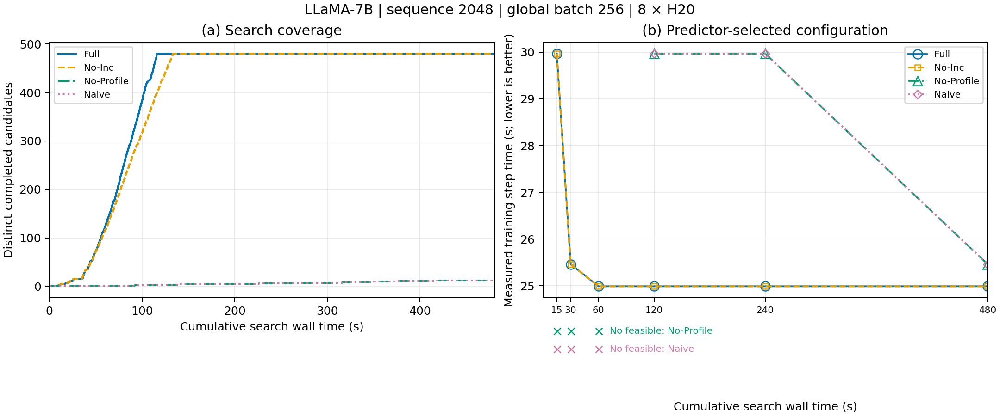

# Devastator 复用机制消融（8×H20，2026-10-12）

LLaMA-7B，序列长度 2048，global batch size 256，FP16；固定原生 KV heads=32，统一使用 Megatron-LM 训练。仅测试 Devastator。

## 结果

| 运行方式 | 增量分析 | 算子 Profile 复用 | 480 秒内完成的不同候选 | 当时获选配置实测步时 | 吞吐 samples/s |
|---|---|---|---:|---:|---:|
| Full | 开 | 开 | 480 | 24.9909 s | 10.2437 |
| No-Inc | 关 | 开 | 480 | 24.9909 s | 10.2437 |
| No-Profile | 开 | 关 | 12 | 25.4625 s | 10.0540 |
| Naive | 关 | 关 | 12 | 25.4625 s | 10.0540 |

Full 约 116.14 秒遍历完 480 个候选，No-Inc 约 133.31 秒。两组从 60 秒时间点开始选中实测 24.99 秒的配置。关闭 Profile 复用的两组在 15、30、60 秒尚无预测可行配置；120、240 秒选中的配置实测 29.97 秒，到 480 秒选中实测 25.46 秒的配置。

本次观测中，Profile 复用增加了有限时间内的覆盖，并更早选到训练更快的配置。增量分析提高遍历速度，但未改变这六个时间点的获选配置。每组一次搜索、每个获选配置一次训练，不作统计显著性推断。



[PDF 图](reuse_ablation.pdf) · [可编辑 SVG](reuse_ablation.svg) · [时间点 CSV](final_timepoints.csv) · [配置与训练证据映射](configuration_training_map.csv) · [完整报告](REPORT_CN.txt)

## 协议与核查

- 480 个候选先去重，以与性能无关的固定哈希顺序遍历。允许 DP、TP、PP、microbatch、selective MLP 重计算、distributed optimizer、VPP；SP 随 TP；CP=UP=1；显存预算 85 GiB。完整取值和合法性规则见[冻结协议](frozen_protocol.json)。
- 预测试后冻结共同时间点 15、30、60、120、240、480 秒。四组独立进程、独立空算子缓存，串行运行；仅共享事先采集的通信标定。
- 使用同一个原生预测器及已有消融开关。修复关闭 Profile 复用时数值代价缓存绕过重新测量的问题，并加入原生单候选评估入口。固定同一组算子值后，四组对全部 480 个候选的分析结果一致；一致性检查专用历史数值不进入正式搜索。
- 计时包含进程启动、初始化、候选生成、分析、Profile 查询/实测和选择开销。预算之后才完成的候选保留原始日志，但不计入对应时间点。
- 各时间点只按当时已完成候选的预测耗时选优。24 个时间点获选配置去重为 3 个，均补跑了一次 10 步八卡训练，无 OOM 或失败；没有用 Galvatron 成绩替代。
- 实测步时：第 6–10 步，每步取八个 rank 的 CUDA 同步整步耗时最大值，再求五步均值；吞吐为 256/平均步时。实际重计算、SP、VPP 和优化器分片参数在所有 rank 上核查。曲线不平滑、不按实测成绩事后改选。

[验收结果](completion_audit.json)已通过。

## 原始证据与复现

下载全部分片：[01](evidence.tar.gz.part-01)、[02](evidence.tar.gz.part-02)、[03](evidence.tar.gz.part-03)。因上传接口限制，完整归档按字节拆分；先按下方命令合并，再解压。解压后根目录为 `20261012-reuse-ablation/`。包含冻结候选、逐候选与逐 Profile 查询日志、逐 rank 训练证据、环境/代码哈希、代码补丁、启动脚本、绘图源码、汇总表及校验清单；不含训练输入、权重或生成的编译缓存。

```bash
cat evidence.tar.gz.part-* > evidence.tar.gz
echo "43da15141299906e4f929ec5e07e97b2ac64e8976b5e6cf430434ca2967a6fff  evidence.tar.gz" | sha256sum -c -
tar -xzf evidence.tar.gz
cd 20261012-reuse-ablation
/opt/hbv/venv/bin/python scripts/plot_results.py
```

该命令从保存的搜索及训练数据重画图。重新执行实验须在具备原 H20 环境和私有输入的新目录中运行，保留已有结果。启动顺序及约束见包内 `REPORT_CN.txt`；`scripts/run_pilot.py`、`freeze_protocol.py`、`run_formal.py`、`train_selected.py` 分别负责预测试、冻结、正式搜索及获选配置验证。根目录旁的 [plot_results.py](plot_results.py) 是便于阅读的源码副本，执行请使用解压包内路径。

归档 SHA256：`43da15141299906e4f929ec5e07e97b2ac64e8976b5e6cf430434ca2967a6fff`。
